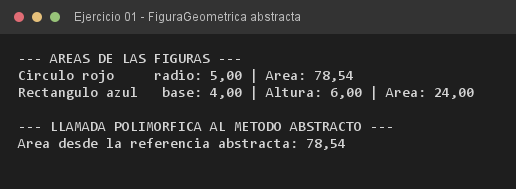

# Ejercicio 01 — FiguraGeometrica

**Objetivo:** comprender el propósito de las clases y métodos abstractos.
**Salida esperada:** áreas de un círculo y un rectángulo calculadas por subclases concretas.

**Conceptos:** clase abstracta · método abstracto · `@Override` · `Math.PI`



```bash
javac -encoding UTF-8 -d bin -sourcepath src src/ejercitacion3_3/ejercicio01/FiguraGeometrica.java
java -cp bin ejercitacion3_3.ejercicio01.FiguraGeometrica
```
