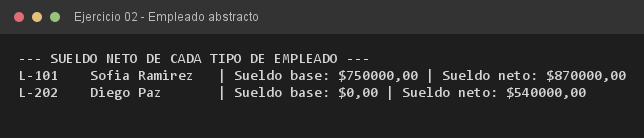

# Ejercicio 02 — Empleado

**Objetivo:** combinar lógica heredable concreta con comportamiento especializado obligatorio.
**Salida esperada:** sueldo neto de un empleado de planta y de uno eventual.

**Conceptos:** clase abstracta · método abstracto · getters · herencia de constructores



```bash
javac -encoding UTF-8 -d bin -sourcepath src src/ejercitacion3_3/ejercicio02/Empleado.java
java -cp bin ejercitacion3_3.ejercicio02.Empleado
```
