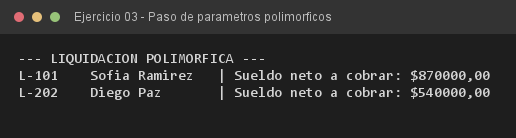

# Ejercicio 03 — LiquidacionSueldos

**Objetivo:** diseñar métodos que reciben un tipo abstracto y desacoplan la lógica cliente.
**Salida esperada:** liquidación del sueldo neto de un empleado de planta y de uno eventual.

**Conceptos:** paso polimórfico · dynamic binding · clase de servicio · desacoplamiento



```bash
javac -encoding UTF-8 -d bin -sourcepath src src/ejercitacion3_3/ejercicio03/LiquidacionSueldos.java
java -cp bin ejercitacion3_3.ejercicio03.LiquidacionSueldos
```
