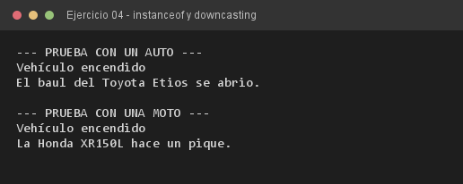

# Ejercicio 04 — Vehiculo

**Objetivo:** aplicar `instanceof` y realizar downcasting de forma segura.
**Salida esperada:** prueba de un auto y de una moto con su acción específica.

**Conceptos:** `instanceof` · downcasting · método estático · polimorfismo



```bash
javac -encoding UTF-8 -d bin -sourcepath src src/ejercitacion3_3/ejercicio04/Vehiculo.java
java -cp bin ejercitacion3_3.ejercicio04.Vehiculo
```
