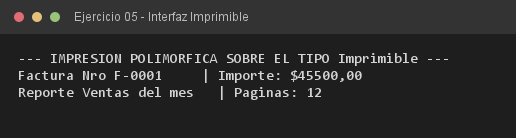

# Ejercicio 05 — Imprimible

**Objetivo:** definir e implementar interfaces separando especificación e implementación.
**Salida esperada:** impresión polimórfica de una factura y de un reporte.

**Conceptos:** `interface` · `implements` · contrato de comportamiento · desacoplamiento total



```bash
javac -encoding UTF-8 -d bin -sourcepath src src/ejercitacion3_3/ejercicio05/Factura.java
java -cp bin ejercitacion3_3.ejercicio05.Factura
```
