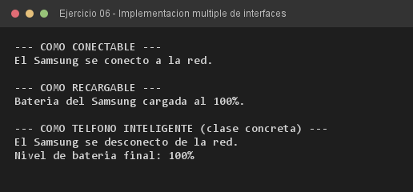

# Ejercicio 06 — TelefonoInteligente

**Objetivo:** implementar múltiples interfaces en una misma clase.
**Salida esperada:** el mismo objeto visto como `Conectable`, como `Recargable` y como clase concreta.

**Conceptos:** implementación múltiple · `implements A, B` · visibilidad según el tipo de referencia



```bash
javac -encoding UTF-8 -d bin -sourcepath src src/ejercitacion3_3/ejercicio06/TelefonoInteligente.java
java -cp bin ejercitacion3_3.ejercicio06.TelefonoInteligente
```
