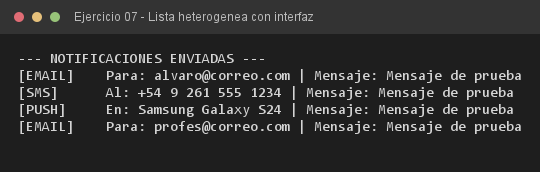

# Ejercicio 07 — Notificable

**Objetivo:** agrupar objetos disímiles en una lista usando una interfaz común.
**Salida esperada:** notificaciones enviadas por email, SMS y push a una lista heterogénea.

**Conceptos:** `ArrayList<Interfaz>` · for-each · lista heterogénea · contrato común



```bash
javac -encoding UTF-8 -d bin -sourcepath src src/ejercitacion3_3/ejercicio07/NotificacionPush.java
java -cp bin ejercitacion3_3.ejercicio07.NotificacionPush
```
