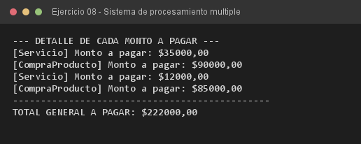

# Ejercicio 08 — Pagable

**Objetivo:** procesar colecciones dinámicas aplicando cálculos polimórficos y acumulando resultados.
**Salida esperada:** detalle de cada monto a pagar y el total general de la lista.

**Conceptos:** `List<Interfaz>` · polimorfismo en el for-each · acumulación · `ArrayList`



```bash
javac -encoding UTF-8 -d bin -sourcepath src src/ejercitacion3_3/ejercicio08/Servicio.java
java -cp bin ejercitacion3_3.ejercicio08.Servicio
```
