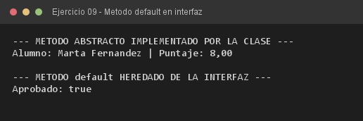

# Ejercicio 09 — Evaluable

**Objetivo:** usar los métodos `default` de las interfaces para dar comportamiento base reutilizable.
**Salida esperada:** puntaje calculado por la clase y aprobado resuelto por el método default.

**Conceptos:** método `default` · interfaz con comportamiento · `>=` · polimorfismo de interfaz



```bash
javac -encoding UTF-8 -d bin -sourcepath src src/ejercitacion3_3/ejercicio09/ExamenEscrito.java
java -cp bin ejercitacion3_3.ejercicio09.ExamenEscrito
```
