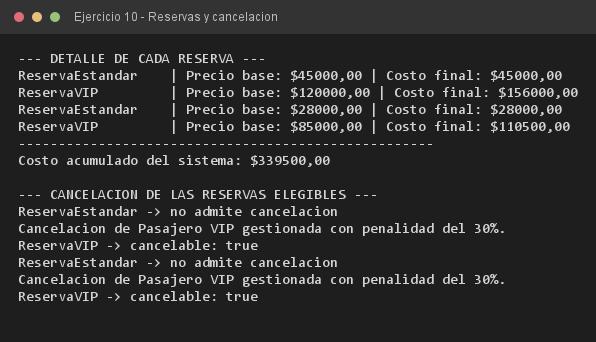

# Ejercicio 10 — Reserva

**Objetivo:** integrar clases abstractas, interfaces y listas heterogéneas en un modelo completo.
**Salida esperada:** costo acumulado de las reservas y cancelación solo de las elegibles.

**Conceptos:** clase abstracta · interfaz opcional · `instanceof Cancelable` · downcasting seguro



```bash
javac -encoding UTF-8 -d bin -sourcepath src src/ejercitacion3_3/ejercicio10/Reserva.java
java -cp bin ejercitacion3_3.ejercicio10.Reserva
```
