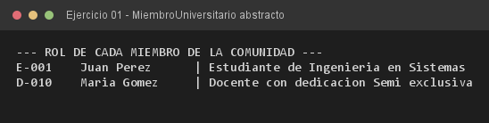

# Ejercicio 01 — MiembroUniversitario

**Objetivo:** comprender el propósito de las clases abstractas y sus contratos.
**Salida esperada:** rol de un estudiante y de un docente calculados por sus subclases.

**Conceptos:** clase abstracta · método abstracto · atributos `protected` · herencia



```bash
javac -encoding UTF-8 -d bin -sourcepath src src/ejercitacion3_4/ejercicio01/MiembroUniversitario.java
java -cp bin ejercitacion3_4.ejercicio01.MiembroUniversitario
```
