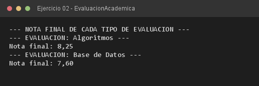

# Ejercicio 02 — EvaluacionAcademica

**Objetivo:** combinar un método concreto heredable con un método abstracto obligatorio.
**Salida esperada:** nota final de un examen parcial y de un trabajo práctico integrador.

**Conceptos:** método concreto · método abstracto · `super()` · ponderación de notas



```bash
javac -encoding UTF-8 -d bin -sourcepath src src/ejercitacion3_4/ejercicio02/EvaluacionAcademica.java
java -cp bin ejercitacion3_4.ejercicio02.EvaluacionAcademica
```
