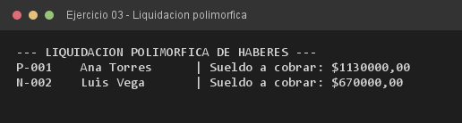

# Ejercicio 03 — PersonalUniversitario

**Objetivo:** diseñar un método que recibe un tipo abstracto sin conocer las subclases.
**Salida esperada:** liquidación del sueldo a cobrar de un titular y de un no docente.

**Conceptos:** polimorfismo · clase de servicio · `dynamic binding` · abstracción



```bash
javac -encoding UTF-8 -d bin -sourcepath src src/ejercitacion3_4/ejercicio03/PersonalUniversitario.java
java -cp bin ejercitacion3_4.ejercicio03.PersonalUniversitario
```
