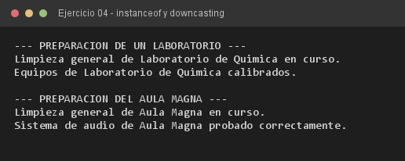

# Ejercicio 04 — EspacioUniversitario

**Objetivo:** aplicar `instanceof` y downcasting defensivo sobre una jerarquía abstracta.
**Salida esperada:** preparación de un laboratorio y de un aula magna con sus pasos propios.

**Conceptos:** `instanceof` · downcasting · método abstracto · método estático cliente



```bash
javac -encoding UTF-8 -d bin -sourcepath src src/ejercitacion3_4/ejercicio04/EspacioUniversitario.java
java -cp bin ejercitacion3_4.ejercicio04.EspacioUniversitario
```
