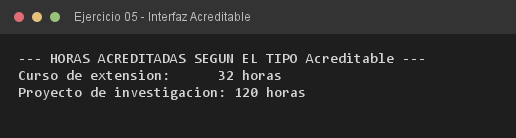

# Ejercicio 05 — Acreditable

**Objetivo:** definir e implementar una interfaz de acreditación de horas.
**Salida esperada:** horas acreditadas de un curso de extensión y de un proyecto de investigación.

**Conceptos:** `interface` · `implements` · respuesta polimórfica · desacoplamiento



```bash
javac -encoding UTF-8 -d bin -sourcepath src src/ejercitacion3_4/ejercicio05/CursoExtension.java
java -cp bin ejercitacion3_4.ejercicio05.CursoExtension
```
