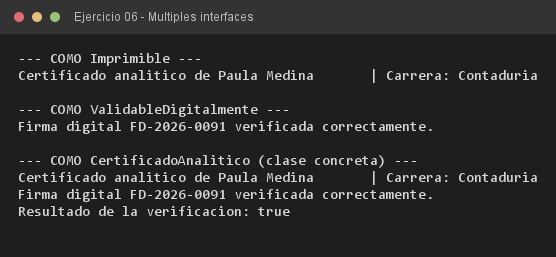

# Ejercicio 06 — CertificadoAnalitico

**Objetivo:** implementar dos interfaces para dar múltiples roles a un mismo objeto.
**Salida esperada:** el certificado impreso y validado según el tipo de referencia usado.

**Conceptos:** implementación múltiple · `implements A, B` · roles operativos · `@Override`



```bash
javac -encoding UTF-8 -d bin -sourcepath src src/ejercitacion3_4/ejercicio06/CertificadoAnalitico.java
java -cp bin ejercitacion3_4.ejercicio06.CertificadoAnalitico
```
