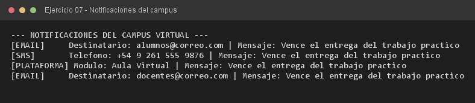

# Ejercicio 07 — NotificableCampus

**Objetivo:** agrupar clases disímiles en una lista usando una interfaz común.
**Salida esperada:** notificaciones enviadas por email, SMS y aviso de plataforma.

**Conceptos:** `ArrayList<Interfaz>` · for-each · colección heterogénea · contrato común



```bash
javac -encoding UTF-8 -d bin -sourcepath src src/ejercitacion3_4/ejercicio07/AvisoPlataforma.java
java -cp bin ejercitacion3_4.ejercicio07.AvisoPlataforma
```
