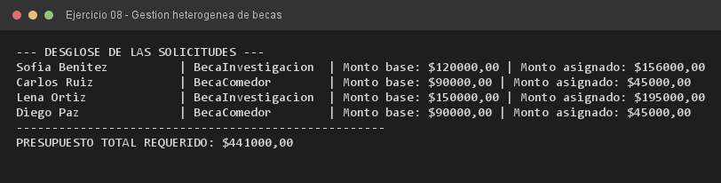

# Ejercicio 08 — SolicitudBeca

**Objetivo:** procesar una colección de clases abstractas acumulando los montos asignados.
**Salida esperada:** desglose de cada solicitud y presupuesto total requerido.

**Conceptos:** clase abstracta · lista de clases abstractas · cálculo acumulado · `@Override`



```bash
javac -encoding UTF-8 -d bin -sourcepath src src/ejercitacion3_4/ejercicio08/SolicitudBeca.java
java -cp bin ejercitacion3_4.ejercicio08.SolicitudBeca
```
