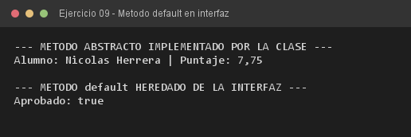

# Ejercicio 09 — Evaluable

**Objetivo:** usar métodos `default` para adicionar comportamiento base a una interfaz.
**Salida esperada:** puntaje del examen oral y aprobado resuelto por el método default.

**Conceptos:** método `default` · interfaz con comportamiento · aprobación por puntaje



```bash
javac -encoding UTF-8 -d bin -sourcepath src src/ejercitacion3_4/ejercicio09/ExamenOral.java
java -cp bin ejercitacion3_4.ejercicio09.ExamenOral
```
