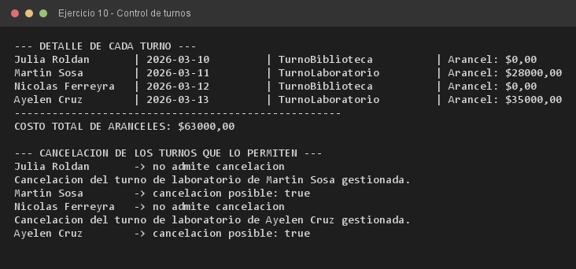

# Ejercicio 10 — ReservaTurno

**Objetivo:** integrar clases abstractas, interfaces y listas heterogéneas en un control de turnos.
**Salida esperada:** costo total de arceles y cancelación solo de los turnos que lo permiten.

**Conceptos:** clase abstracta · interfaz opcional · `instanceof Cancelable` · lista heterogénea



```bash
javac -encoding UTF-8 -d bin -sourcepath src src/ejercitacion3_4/ejercicio10/ReservaTurno.java
java -cp bin ejercitacion3_4.ejercicio10.ReservaTurno
```
